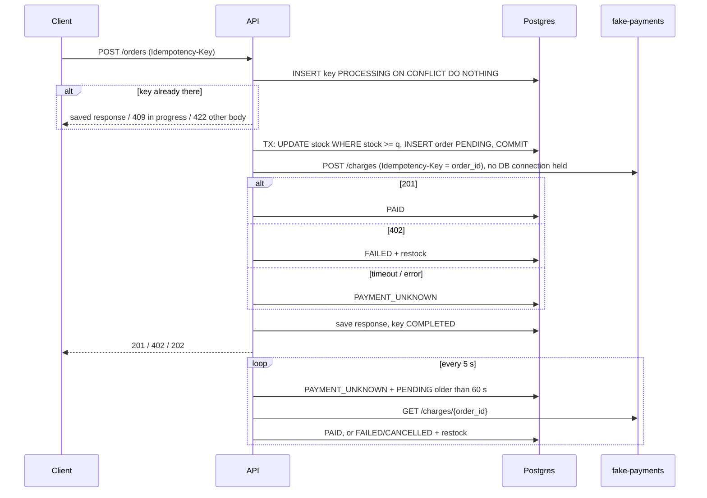

# order-processing-system

An order API that, under heavy concurrency and when things crash, **never charges twice and never sells more than it has in stock**, with the numbers to prove it.

FastAPI + PostgreSQL 16 + psycopg 3 (hand-written SQL, no ORM) + a fake Stripe (`fake-payments`) that fails, times out and remembers idempotency keys.

## Results

All numbers below are from real runs on one PC (Ryzen 5 7600X, 32 GB, Windows 11), **without Docker**: `scripts/local_stack.py` runs the same code with a native Postgres 16.2 (pip package `pgserver`) and uvicorn processes. Raw output is in `results/`. Docker numbers are still to come.

### M3: 1000 buyers, 1 product (raw: `results/race.txt`, 5 runs per row, 50 DB connections)

| mode | stock | sold | stock left | oversold | lost updates | time (median, min-max) |
|---|---|---|---|---|---|---|
| `naive` (read in Python, write back) | 100 | **1000** | 65-81 | **900** | 965-981 | 1.78 s (1.73-1.84) |
| `atomic` (`UPDATE ... WHERE stock >= q`) | 100 | 100 | 0 | 0 | 0 | 0.92 s (0.91-0.97) |
| `for_update` (`SELECT ... FOR UPDATE`) | 100 | 100 | 0 | 0 | 0 | 0.98 s (0.96-1.03) |
| `naive` | 1000 | 1000 | 971-984 | 0 | 971-984 | 1.80 s (1.72-1.87) |
| `atomic` | 1000 | 1000 | 0 | 0 | 0 | 1.75 s (1.71-1.80) |
| `for_update` | 1000 | 1000 | 0 | 0 | 0 | 1.85 s (1.83-1.87) |

The naive bug sells **10x the stock** and the DB still says items are left. Both fixes are always exact. `atomic` is ~6% faster than `for_update` here (one round trip less while holding the row lock); on localhost the round trip is tiny, so expect a bigger gap over a real network.

### M4: same request 50x with one Idempotency-Key (raw: `results/replay.txt`, 3 runs)

25 sent at the same moment + 25 one by one: `orders=1 charges=1` in every run (26x 201 with an identical body, 24x 409 "request in progress"). Same key with another body: **422**.

### M5 / M6: 1000 orders, payment provider with `FAIL_RATE=0.2 TIMEOUT_RATE=0.1` (raw: `results/chaos_m5.txt`, `results/chaos_m6.txt`)

| run | API kills | client saw PAYMENT_UNKNOWN | final PAID / FAILED / CANCELLED | duplicate_charges | oversell | unknown left |
|---|---|---|---|---|---|---|
| M5 #1 | 0 | 98 | 709 / 244 / 0 | 0 | 0 | 0 |
| M5 #2 | 0 | 99 | 681 / 264 / 0 | 0 | 0 | 0 |
| M5 #3 | 0 | 94 | 698 / 273 / 0 | 0 | 0 | 0 |
| M6 #1 | 4 (hard kill) | 39 | 704 / 234 / 25 | 0 | 0 | 0 |
| M6 #2 | 4 | 16 | 681 / 222 / 44 | 0 | 0 | 0 |
| M6 #3 | 4 | 22 | 675 / 224 / 32 | 0 | 0 | 0 |

Every PAID order has exactly one succeeded charge, and no other order has one. `check_invariants.py` is itself tested against deliberately broken states (`scripts/test_check_invariants.py`) and was shown to fail on a real DB with one corrupted stock value.

### M7: load (k6)

**Not measured yet**: k6 and Docker are not installed on the dev PC. The script (`load/orders.js`) and the containerized run are ready; numbers will go into `results/load.json` and this table.

## How it works



## Run it

```bash
docker compose up -d                       # postgres + fake-payments + api on :8000
curl localhost:8000/health                 # {"status":"ok"}
docker compose exec api pytest             # API tests (they wipe the DB)

pip install -r scripts/requirements.txt    # scripts run on the host
python scripts/race.py --mode naive --buyers 1000 --stock 100      # also: atomic, for_update
python scripts/replay.py --repeats 50
FAIL_RATE=0.2 TIMEOUT_RATE=0.1 docker compose up -d
python scripts/chaos.py --orders 1000 [--kill-api-every 200]       # wipes the DB first
python scripts/check_invariants.py
docker compose exec -T postgres psql -U app -d shop -f - < load/seed.sql
docker compose --profile load run --rm k6                          # -> results/load.json
```

Without Docker (Windows): `python -m venv .venv`, install `api/requirements.txt`, `fake-payments/requirements.txt` and `pgserver`, run `python scripts/local_stack.py`, and point the scripts at the printed `DATABASE_URL` plus `API_URL=http://127.0.0.1:8000 PAYMENTS_URL=http://127.0.0.1:9000`. For M6 use `--restart-cmd` with a command that kills the PID in `.api.pid` (the stack restarts it).

> Status: the Docker path (compose, Dockerfiles, CI) is written and syntax-checked but has **not been run** yet.

## Decisions

- **Atomic conditional UPDATE on READ COMMITTED**, not SERIALIZABLE: Postgres re-checks the `WHERE stock >= q` after waiting for the row lock, so it cannot oversell. SERIALIZABLE would turn 1000 buyers on one row into a storm of serialization errors and retries.
- **Payment call outside the transaction and without a pooled connection**: a 3 s timeout inside a transaction would hold the product's row lock and drain the 20-connection pool.
- **Timeout is PAYMENT_UNKNOWN, never FAILED**: the charge may have happened. The reconciler asks the provider later; the provider key is the order id, so nothing is charged twice.
- **Every status change is guarded** (`WHERE status IN (...)`), and stock is returned only by whoever won that change, so API and reconciler cannot both restock.
- **Locks taken in product-id order** to avoid deadlocks on multi-item orders.
- **Pool 10-20 connections, 503 + Retry-After when it is exhausted for 10 s**: Postgres allows 100 connections; more connections would not help a hot row anyway.
- **422 for a reused key with another body** (Stripe uses a 400-class error too); 409 while the first request is still running, like Stripe.
- **race.py talks to Postgres directly** using the API's own `reserve()` function: it isolates the locking part from HTTP noise.

## Known limits (where M6 stops)

- If the API dies while a key is PROCESSING, retries with that key get 409 until the client gives up (56-88 of 1000 clients per M6 run). Money and stock are still correct, the client just gets no answer. Fix: `locked_at` + takeover of stale keys.
- An order cut off by a crash before the charge is **cancelled** after 60 s instead of completed. An outbox + worker would finish it (bonus phase).
- The reconciler trusts a provider 404 as "never charged". True for fake-payments (it records synchronously); with a real provider, re-send the charge with the same key instead.
- fake-payments keeps charges in memory; the crash test kills only the API. Idempotency keys are never pruned (Stripe prunes after 24 h).
